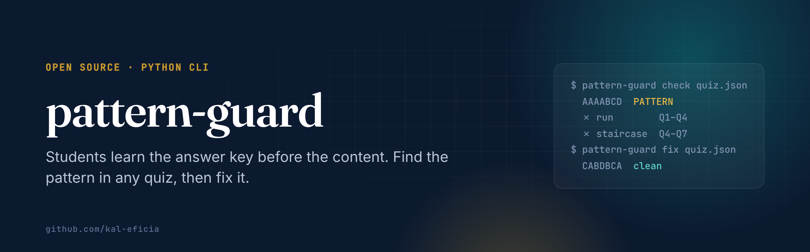

<p align="center"></p>

<p align="center">
  <a href="https://github.com/kal-eficia/pattern-guard/actions/workflows/tests.yml"></a>
  
  
  
</p>

Students spot answer patterns fast. If the last three answers were **B, C, D**, a Year 9 will pick **A** without reading the question. Most quiz tools shuffle options at random, and random still produces runs and staircases, so the key keeps leaking.

**pattern-guard** reads a quiz, writes out the correct-answer positions as a key, and tells you exactly where it gives itself away. Then it rebuilds the option order so the key is clean, evenly spread and still marks every answer correctly.

```text
$ pattern-guard check examples/networks-quiz.json
examples/networks-quiz.json · MCQ  AAAABCD  PATTERN
  ✗ run         Q1-Q4         A is correct 4 times in a row
  ✗ staircase   Q4-Q7         key climbs in order: A B C D
  ✗ lopsided    Q1-Q7         A is correct 4 of 7 times
examples/networks-quiz.json · sort #8  Inp Inp Inp Out Out Out  PATTERN
  ✗ run         items 1-3     Input items 3 times in a row
  ✗ run         items 4-6     Output items 3 times in a row

$ pattern-guard fix examples/networks-quiz.json -o fixed.json --seed 3
$ pattern-guard check fixed.json
fixed.json · MCQ  CABACBD  clean
```

## What it catches

| Pattern | Looks like | Default |
|---|---|---|
| Repeat | `C A A D` | fail (use `--lenient` to allow) |
| Run | `B B B` | fail |
| Staircase | `A B C` · `D C B` | fail |
| Alternation | `A C A C` | fail |
| Repeating block | `A C B · A C B` | fail |
| Lopsided spread | one letter correct more than half the time | fail |
| Unused position | `D` never correct across a long quiz | warning |

Sort and match tasks get the same treatment on the order of their buckets, so you never list every *Input* item and then every *Output* item.

## Install

```bash
pip install git+https://github.com/kal-eficia/pattern-guard
```

Or copy the `pattern_guard/` folder into your project. It has no dependencies.

## Use it

```bash
pattern-guard check quiz.json other-quiz.json   # exit code 1 if any pattern fails
pattern-guard fix quiz.json -o quiz.fixed.json  # reorder options, answers stay correct
pattern-guard check --key CADBDACB              # check a key you already have
pattern-guard plan 12 --options 4 --seed 7      # a fresh clean key to build a quiz around
```

The exit code makes it easy to drop into a build step or a pre-commit hook, so no quiz goes out with a leaky key.

### Quiz format

```json
{
  "title": "Networks starter",
  "questions": [
    { "q": "What does a MAC address identify?", "options": ["A website", "A network interface", "A user", "A file"], "answer": 1 },
    { "q": "Which protocol is secure?", "options": ["FTP", "HTTPS", "SMTP", "POP3"], "answer": "HTTPS" },
    { "type": "sort", "items": [ { "text": "Keyboard", "bucket": "Input" }, { "text": "Speaker", "bucket": "Output" } ] }
  ]
}
```

`answer` can be the option's index, its text, or a letter.

### From Python

```python
from pattern_guard import analyse, plan_key, fix_file

report = analyse([0, 0, 0, 1, 2, 3], options=4)
report.ok          # False
report.findings    # [Finding(rule='run', ...), Finding(rule='staircase', ...)]

plan_key(10, 4, seed=1)   # e.g. [1, 3, 0, 3, 2, 0, 1, 2, 0, 3]
```

## How the fix works

1. Plan a key first: a balanced bag of positions, placed one at a time with backtracking so no step creates a run, staircase, alternation or repeating block.
2. Move each correct option to its planned slot and shuffle the distractors around it. Question wording is never touched.
3. Check the result again. The tests run hundreds of seeds to prove planned keys come out clean and balanced.

## Run the tests

```bash
python -m unittest discover -s tests
```

## Related

- [lesson-page-kit](https://github.com/kal-eficia/lesson-page-kit): student lesson pages that plan pattern-free keys automatically
- [ai-teaching-skills](https://github.com/kal-eficia/ai-teaching-skills): the `no-answer-patterns` skill bundles this checker for AI assistants

---

Built by [Kalid Nur](https://github.com/kal-eficia), who teaches Computer Science and ICT and got tired of watching students beat the key instead of the question. MIT licence.
